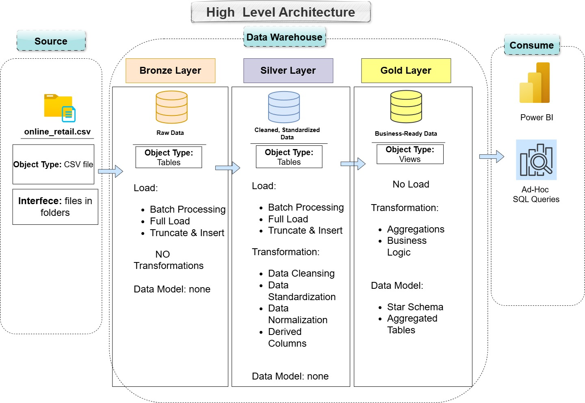
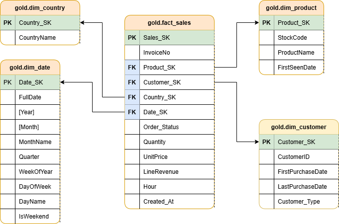

# Retail Data Warehouse for Reliable Business Reporting

**SQL Server · T-SQL · Data Quality · Dimensional Modeling**

This project turns more than **500,000 raw retail transaction lines** into a clean, structured data model that can support dependable dashboards and analysis.

## The business problem

Raw transaction files are difficult to report from directly. This dataset contains duplicate rows, cancelled orders, invalid quantities, missing customer IDs and sales across many countries.

Without clear cleaning rules, different reports can produce different answers to the same business question.

## The solution

I built a three-stage data pipeline that separates raw data, cleaned data and reporting-ready data.

| Stage | Plain-English purpose |
| --- | --- |
| **Bronze** | Keeps the original source data unchanged for traceability. |
| **Silver** | Removes exact duplicates and standardizes the transaction records. |
| **Gold** | Applies business rules and organizes the data into a model designed for reporting. |

## What the final model supports

The Gold layer makes it easier to answer questions such as:

- How is revenue changing by month, quarter or country?
- Which products generate the most sales?
- Which customers are new, returning or high value?
- How do retail and wholesale buying patterns differ?
- When are the strongest and weakest sales periods?

The model contains one central sales table connected to customer, product, date and country tables. This structure keeps Power BI reporting fast, clear and consistent.

## Important data-quality decisions

- Exact duplicate transaction lines are removed.
- Cancelled invoices are excluded from sales reporting.
- Zero or negative quantities and prices are excluded from revenue.
- Missing customer IDs are retained through generated guest-customer records.
- Revenue is calculated consistently as quantity × unit price.
- The reporting tables use stable internal keys and analytical indexes.

## Project files

| File | What it does |
| --- | --- |
| ddl_database_and_schemas.sql | Creates the database and Bronze, Silver and Gold areas. |
| loading_bronze.sql | Loads the original CSV data without transformation. |
| silver_build.sql | Cleans and standardizes transaction-level data. |
| gold_star_schema_build.sql | Builds the reporting model and applies business rules. |

Run the scripts in the order shown above.

## Outcome

The result is a repeatable SQL workflow and a single reporting foundation for revenue, customer, product and time analysis.

This project demonstrates that I can:

- Translate messy operational data into a trustworthy reporting model
- Define business rules clearly and apply them consistently
- Design data structures for Power BI and management reporting
- Document both the process and the assumptions behind the numbers

## Related dashboard project

See the reporting layer in action in [Power BI Retail Analytics](https://github.com/mahssan750/online_retail_dashboards).

## Dataset

Public UK online retail transactions from 2010–2011, available on [Kaggle](https://www.kaggle.com/datasets/ulrikthygepedersen/online-retail-dataset).

## Tools demonstrated

**SQL Server · T-SQL · ETL · Data Cleaning · Star Schema · Power BI-ready Modeling**
